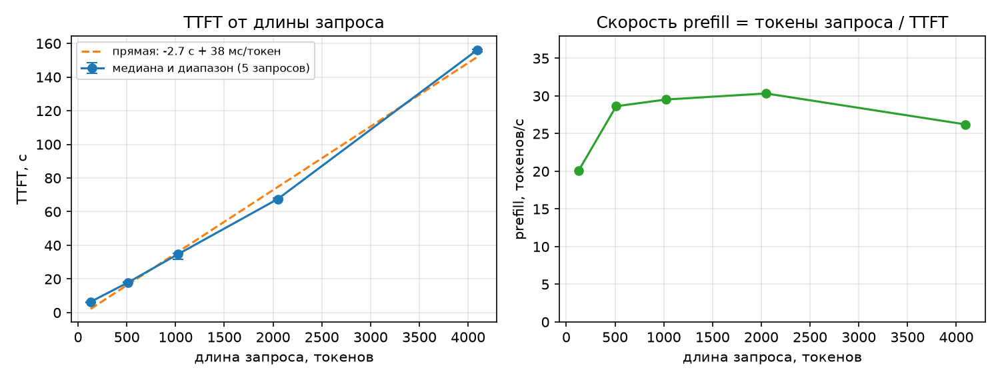
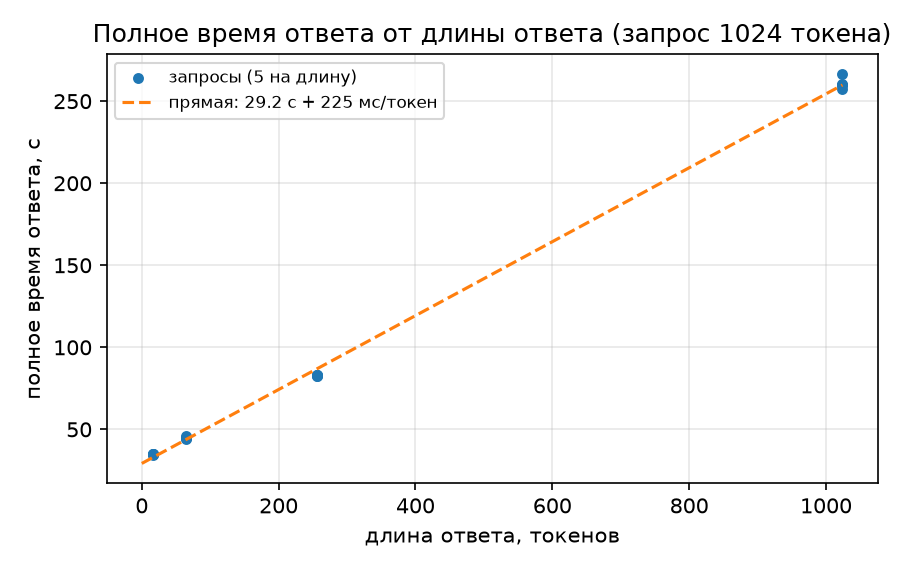
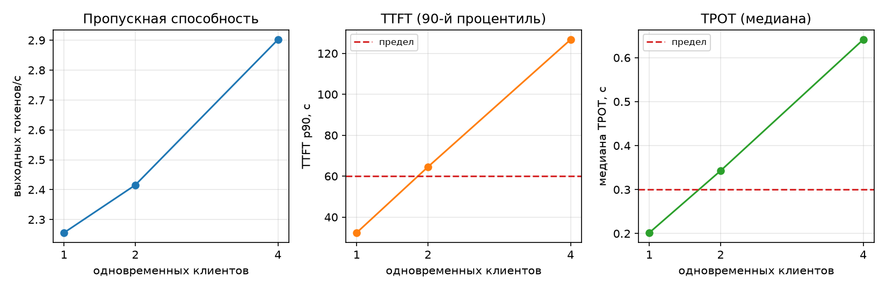

# ЛР1. Инференс и развёртывание языковой модели: от одного запроса к серверу под нагрузкой

## Введение

Пользователь языковой модели ждёт дважды: пока появится первое слово ответа и пока допечатается весь текст; у этих ожиданий разные причины, а когда пользователей много, ожидание растёт. Цель работы — развернуть собственный сервер модели с OpenAI-совместимым API, измерить, как время ответа зависит от длины запроса, длины ответа и числа одновременных клиентов, и объяснить результат устройством генерации. Задачи: паспорт сервера и клиент-измеритель в каркасе ЛР0; расчёт памяти весов и KV-кеша с проверкой по журналу сервера; три эксперимента (длина запроса, длина ответа, нагрузка); отчёт, таблицы и графики которого строятся скриптом. Объект — сервер llama.cpp с моделью Qwen3-4B-Instruct-2507 на CPU ноутбука; предмет — TTFT, TPOT, пропускная способность и предел нагрузки.

## 1 Теоретические сведения

Генерация состоит из двух этапов [1, 2]. На этапе prefill модель за один проход обрабатывает все токены запроса параллельно; этап упирается в вычисления, его результат — первый токен ответа. На этапе decode модель выдаёт по токену за шаг; каждый шаг читает из памяти все веса, а вычислений мало, поэтому этап упирается в скорость памяти. Чтобы не пересчитывать текст, модель хранит ключи и значения внимания прошлых токенов — KV-кеш [3]: M = 2 · n_слоёв · n_KV · d_головы · b · L (L — число токенов, b — байт на число). У Qwen3-4B-Instruct-2507 36 слоёв, 8 голов KV размерности 128, в FP16 это 2 · 36 · 8 · 128 · 2 = 147 456 байт = 144 КиБ на токен. Метрики по отметкам клиента (t0 — перед отправкой, t1 — первый фрагмент, tN — последний): TTFT = t1 − t0; TPOT = (tN − t1) / (N − 1); полное время tN − t0 ≈ TTFT + (N − 1) · TPOT; пропускная способность — выходные токены в секунду у всех пользователей; goodput — запросы в секунду, уложившиеся в пределы TTFT и TPOT [5]. При нескольких клиентах сервер объединяет запросы в батч [4]: веса читаются один раз на батч, но шаг длиннее, а prefill нового запроса задерживает остальных. Кеш префикса позволяет пропустить prefill уже обработанного начала запроса.

## 2 Реализация и паспорт сервера

**Сервер.** Профиль CPU из методички: llama.cpp (сборка b12406), Qwen3-4B-Instruct-2507 в GGUF Q4_K_M (2,50 ГБ), Intel Core i5-10300H (4 ядра, 8 потоков), ОЗУ 7,87 ГиБ, без GPU. Контекст 8192 вместо рекомендованных 16384: KV-кеш при 16384 занял бы 2,25 ГиБ, а свободно было 3–4 ГиБ. Один слот в экспериментах 1–2, четыре слота (по 2048 токенов) в эксперименте 3. Команды запуска со всеми флагами, SHA-256 файла модели (совпал с хешем на Hugging Face), версия сервера и ревизия репозитория модели — в `report/server_passport.md` и `metadata.json` каждого запуска; адрес и параметры генерации (температура 0) — в `endpoint.yaml` для ЛР2–ЛР8.

**Клиент.** потоковый запрос с `include_usage`, отметки t0, t1, tN по `time.perf_counter()`, токены из `usage`. Запрос заданной длины строится из «Pride and Prejudice» (Project Gutenberg № 1342, хеш в `data/manifest.json`): уникальная метка в начале, инструкция «Summarize the following text in one sentence.» и текст; длина считается токенизатором и шаблоном сервера (`/tokenize`, `/apply-template`) и сверяется с `usage.prompt_tokens`. Длина ответа — `max_tokens` и `ignore_eos`. Прогрев перед каждой серией помечен и в статистику не входит. Каталог запуска как в ЛР0 (`config.yaml`, `metadata.json`, `results.jsonl` с записью на каждый запрос, включая неудачные, `metrics.json` из `results.jsonl`), запуск регистрируется в MLflow.

**Проверки.** 10 тестов pytest без сервера (при t0 = 0, t1 = 0,4 с, tN = 2,4 с, N = 101 TTFT = 400 мс, TPOT = 20 мс; 144 КиБ на токен; неуспешные запросы остаются в знаменателе; отказ от запуска из «грязного» дерева) и четыре проверки на сервере (`report/server_checks_np*.json`): `max_tokens = 64` с `ignore_eos` даёт ровно 64 токена; один запрос при температуре 0 дважды подряд дал одинаковый текст; запрос на 1024 токена дал `prompt_tokens = 1024`; ёмкость KV-кеша из журнала (1152 МиБ) совпала с расчётом 8192 · 144 КиБ.

**Память.** веса 2,50 ГБ (в FP16 около 8 ГБ); KV-кеш 32 768 токенов — 4,5 ГиБ; 8 пользователей по 4000 токенов — 4,39 ГиБ, с весами около 6,7 ГиБ при 7,87 ГиБ ОЗУ всего — на этом ноутбуке не поместится. Контекст 8192 (1152 МиБ) вмещает двух пользователей по 4000 токенов.

## 3 Прогноз

Прогноз записан и закоммичен до итоговых запусков (`hypothesis.md`). До него на сервер отправлен один пробный запрос (14 токенов, ответ 64 токена): около 5,2 токена/с на decode; в статистику он не входит. Ожидания (сверка — в разделе 5): TTFT почти линейно растёт с длиной запроса, prefill 20–50 токенов/с; кеш префикса сокращает TTFT в десятки раз; TPOT 0,12–0,25 с и не зависит от длины ответа; пропускная способность при росте клиентов вырастет слабо; пределы (TTFT у 90 % запросов ≤ 60 с, медиана TPOT ≤ 0,30 с) выдержит один клиент.

## 4 Результаты экспериментов

### 4.1 Эксперимент 1. Длина запроса и TTFT

Сервер с 1 слотом, ответ 16 токенов, по 5 запросов на длину, кеш префикса выключен (`cache_prompt: false` и уникальная метка), запуск `20261115-171005-exp1_ttft_vs_prompt-2f5b7e`. TTFT вырос с 6,37 с на 128 токенах до 156,21 с на 4096; прямая по 25 запросам — 37,8 мс на токен. Скорость prefill (токены запроса / TTFT) около 26–30 токенов/с: на коротком запросе ниже (20,1) из-за постоянной составляющей TTFT около 2 с, на 4096 токенах падает (26,2): внимание растёт квадратично.

**Таблица 1 – Эксперимент 1: TTFT и скорость prefill (медиана, диапазон по 5 запросам)**

| Длина запроса | Токенов по usage | ok / запл. | TTFT медиана, с | TTFT диапазон, с | Prefill, ток./с |
|---|---|---|---|---|---|
| 128 | 128 | 5/5 | 6,37 | 6,03–6,49 | 20,1 |
| 512 | 512 | 5/5 | 17,88 | 17,72–18,01 | 28,6 |
| 1024 | 1024 | 5/5 | 34,68 | 31,80–35,23 | 29,5 |
| 2048 | 2048 | 5/5 | 67,51 | 67,04–67,96 | 30,3 |
| 4096 | 4096 | 5/5 | 156,21 | 154,79–156,51 | 26,2 |

Кеш префикса (включён, один запрос на 2048 токенов три раза подряд): TTFT 71,93 → 2,35 → 2,28 с, второй запрос быстрее в 30,7 раза: сервер пропускает prefill и дочитывает лишь последний токен.

### 4.2 Эксперимент 2. Длина ответа и скорость генерации

Запрос 1024 токена, ответ 16, 64, 256 и 1024 токена (`ignore_eos`), по 5 запросов, запуск `20261115-174249-exp2_latency_vs_output-eb11eb`; длина ответа по `usage` совпала с заданной во всех 20 запросах. Медиана TPOT: 0,200, 0,199, 0,200 и 0,222 с; полное время — 34,7, 44,6, 83,1 и 260,1 с. Прямая по 20 запросам: 29,2 с + 0,225 с на токен — свободный член близок к TTFT (медиана 31,9 с), наклон — к TPOT. Нижняя граница TPOT: 2,50 ГБ весов при памяти около 46,9 ГБ/с (теоретический максимум двухканальной DDR4-2933; реальная конфигурация памяти не проверялась) даёт 0,053 с; измеренный TPOT 0,200 с в 3,8 раза выше (причина по профилю не проверялась).

*Рисунок 1 – TTFT и скорость prefill от длины запроса*

*Рисунок 2 – Полное время ответа от длины ответа*

### 4.3 Эксперимент 3. Нагрузка

Сервер с 4 слотами, запросы по 1024 токена с разным текстом, ответ 128 токенов; клиент шлёт следующий запрос, получив ответ на предыдущий; запросов на уровень max(16, 4c) = 16; запуск `20261115-190527-exp3_load_v2-fe6bd0`. Пределы заданы до опыта: TTFT у 90 % запросов ≤ 60 с, медиана TPOT ≤ 0,30 с. Пропускная способность — выходные токены за время от первого отправленного до последнего полученного ответа (с учётом prefill). У llama.cpp нет метрики заполнения KV-кеша (нули в `metrics.json` — значение по умолчанию); очередь видна по `requests_deferred`.

**Таблица 2 – Эксперимент 3: нагрузка (16 запросов на уровень)**

| Клиентов | ok / запл. | Токенов/с | TTFT мед., с | TTFT p90, с | TPOT мед., с | goodput, зап./с | В пределах |
|---|---|---|---|---|---|---|---|
| 1 | 16/16 | 2,26 | 30,9 | 32,4 | 0,202 | 0,018 | да |
| 2 | 16/16 | 2,42 | 61,6 | 64,5 | 0,343 | 0,000 | нет |
| 4 | 16/16 | 2,90 | 94,3 | 126,7 | 0,641 | 0,000 | нет |

Один клиент укладывается в пределы (TTFT p90 32,4 с, TPOT 0,202 с); два — нет (64,5 с и 0,343 с, goodput 0), четыре — тем более (126,7 с и 0,641 с). Пропускная способность выросла лишь с 2,26 до 2,90 токенов/с (в 1,3 раза): prefill (около 30 с на запрос) вычислительный и не распараллеливается на четырёх ядрах, поэтому TTFT p90 растёт почти как c · TTFT одного клиента (64,5 ≈ 2 · 32,4, 126,7 ≈ 4 · 32,4), а decode делит ядра с чужим prefill, и TPOT растёт втрое. Очереди до сервера нет (`requests_deferred` = 0): слотов четыре, как клиентов; KV-кеш в 1152 МиБ разделён на слоты по 2048 токенов, запрос занимает 1152 токена, поэтому на слот приходится один запрос и сопоставить начало очереди с ёмкостью кеша не удалось.

*Рисунок 3 – Нагрузка: пропускная способность, TTFT p90 и медиана TPOT (пределы — пунктир)*

### 4.4 Разбор примеров

Первая серия эксперимента 3 (`20261115-182242-exp3_load-2cfe2a`) дала 15 из 16 успешных запросов на уровнях 2 и 4: первый запрос уровня падал с `RuntimeError: Event loop is closed` ещё до обращения к серверу — один асинхронный клиент использовался в нескольких вызовах `asyncio.run`. Это ошибка обвязки; неудачные записи сохранены и не пересчитывались, клиент теперь создаётся внутри каждого уровня, эксперимент выполнен заново отдельной серией (`exp3_load_v2`, 16 из 16). Две серии показывают разброс: TPOT при двух клиентах 0,399 и 0,343 с, при четырёх 0,727 и 0,641 с (до 16 %); вывод о пределах не меняется. Ещё один пример: при ответе в 1024 токена TPOT вырос с 0,200 до 0,222 с — растущий KV-кеш делает каждый шаг тяжелее. Дополнительная проверка вне серий (`report/extra_temp0_check.json`): один и тот же запрос при температуре 0 дал одинаковый текст при двух последовательных запусках, но другой (расхождение с 233-го символа, 83 и 80 токенов) при выполнении параллельно с тремя другими запросами — батчи собираются иначе, а сложение чисел с плавающей точкой не ассоциативно.

## 5 Сверка с прогнозом

**Таблица 3 – Сверка прогноза с результатом**

| Прогноз | Результат | Вывод |
|---|---|---|
| TTFT линейно растёт с длиной запроса, prefill 20–50 ток./с | 37,8 мс/токен, prefill 20–30 ток./с | подтвердился (низ диапазона) |
| Кеш префикса: TTFT в десятки раз меньше | 71,93 → 2,35 с, в 30,7 раза | подтвердился |
| TPOT 0,12–0,25 с, от длины ответа почти не зависит | 0,200–0,222 с | подтвердился |
| Пропускная способность вырастет слабо | 2,26 → 2,90 ток./с (в 1,3 раза) | подтвердился |
| При 4 клиентах TTFT p90 90–150 с, TPOT 0,4–0,8 с | 126,7 с, 0,641 с | подтвердился |
| Пределы выдерживает 1 клиент; очереди нет | выдерживает 1; `requests_deferred` = 0 | подтвердился |

## 6 Выводы и границы

Время до первого слова определяется prefill и растёт линейно с длиной запроса (6,37 с на 128 токенов, 156,21 с на 4096), время каждого следующего — decode и почти не зависит от длины ответа (0,200 с на токен, около 5 токенов/с). Кеш префикса снимает prefill для повторяющегося начала запроса (в 30,7 раза). Под нагрузкой суммарная скорость почти не растёт, а ожидание каждого клиента растёт: сервер обслуживает в пределах (TTFT p90 ≤ 60 с, TPOT ≤ 0,30 с) **одного пользователя**. Для ЛР2–ЛР8: по этим измерениям запрос RAG с контекстом 2048 токенов стоит около 67 с до первого слова (240 вызовов эксперимента 1 ЛР2 — по оценке порядка 5–9 часов), а для агента ЛР4 (контекст не менее 16 тыс. токенов, описания 24 инструментов около 4 тыс. токенов в каждом вызове) сервер недостаточен: контекст 16 384 не помещается в память, а вызов без кеша — около 2,6 минуты. Для ЛР4–ЛР8 нужен GPU (Colab/Kaggle T4 с vLLM) или внешний API; при смене сервера базовый прогон повторяется. Границы: одна машина, 5 запросов на условие, эксперименты 1–2 выполнены по разу, эксперимент 3 — дважды (разброс до 16 %); модель Q4_K_M, контекст 8192; ноутбук не изолирован от других процессов; скорость памяти и причина отставания TPOT от нижней границы не измерялись; текст при температуре 0 под нагрузкой может отличаться от текста при одиночном запросе (4.4).

## 7 Кодогенерация и проверка

Код клиента, генератора запросов, метрик и скриптов сгенерирован с помощью языковой модели и проверен: тестами pytest на известных примерах (TTFT 400 мс и TPOT 20 мс; 144 КиБ на токен; 4,5 ГиБ для 32 768 токенов); проверками на сервере (64 токена, температура 0, длина запроса по `usage`, KV-кеш по журналу); знаменателем — все запланированные запросы (неудачные остаются в `results.jsonl`); пересчётом `metrics.json` из `results.jsonl` при построении отчёта; таймером `perf_counter` вокруг запроса; прогревом вне статистики. Числа в отчёт вручную не переписывались: таблицы и графики строит `make_report.py`. Проверка нашла ошибку клиента нагрузки (4.4).

## Заключение

Развёрнут сервер llama.cpp с Qwen3-4B-Instruct-2507 (Q4_K_M) на CPU, написан клиент-измеритель в каркасе ЛР0, выполнены три эксперимента с прогнозом до запусков. TTFT пропорционален длине запроса, TPOT постоянен около 0,2 с, кеш префикса ускоряет повторный запрос в 31 раз; под нагрузкой пропускная способность выросла в 1,3 раза, а в пределы интерактивности укладывается один клиент. Код, конфигурации, паспорт сервера, прогноз и отчёт — в репозитории [10], артефакты запусков — в архиве.

## Список использованных источников

1. Hugging Face. LLM Course: How do Transformers work? [Электронный ресурс]. – URL: https://huggingface.co/learn/llm-course (дата обращения: 15.11.2026).
2. Databricks. LLM Inference Performance Engineering: Best Practices [Электронный ресурс]. – URL: https://www.databricks.com/blog/llm-inference-performance-engineering-best-practices (дата обращения: 15.11.2026).
3. Pope R. [et al.] Efficiently Scaling Transformer Inference // MLSys. – 2023.
4. Kwon W. [et al.] Efficient Memory Management for Large Language Model Serving with PagedAttention // SOSP. – 2023.
5. Zhong Y. [et al.] DistServe: Disaggregating Prefill and Decoding for Goodput-optimized Large Language Model Serving // OSDI. – 2024.
6. llama.cpp. llama-server [Электронный ресурс]. – URL: https://github.com/ggml-org/llama.cpp/tree/master/tools/server (дата обращения: 15.11.2026).
7. Qwen3-4B-Instruct-2507: карточка модели [Электронный ресурс]. – URL: https://huggingface.co/Qwen/Qwen3-4B-Instruct-2507 (дата обращения: 15.11.2026).
8. OpenAI. API Reference: Chat Completions [Электронный ресурс]. – URL: https://platform.openai.com/docs/api-reference/chat (дата обращения: 15.11.2026).
9. Austen J. Pride and Prejudice. Project Gutenberg, № 1342 [Электронный ресурс]. – URL: https://www.gutenberg.org/ebooks/1342 (дата обращения: 15.11.2026).
10. Митина В. Р. Репозиторий лабораторной работы 1 «intsys-lr1» (git, ветка main; адрес на GitHub будет указан после публикации).
